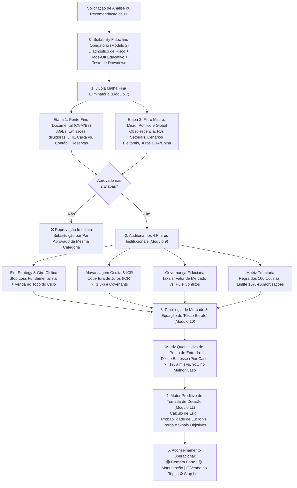

# 🧠📈 Skills de Investimentos — Frameworks Analíticos Padrão Institucional (CNPI / Quant) para Agentes de IA

[](https://github.com/Xinseto/Skills-Investimentos)
[](https://github.com/Xinseto/Skills-Investimentos)
[](https://github.com/Xinseto/Skills-Investimentos)
[](#licença-e-disclaimer-legal)

Repositório público de **Skills de Inteligência Financeira, Análise Fundamentalista e Modelagem Preditiva** projetadas para transformar Agentes de IA e LLMs em **Analistas de Investimentos Sêniores (padrão CNPI / Quant / Institucional)**.

Diferente de prompts genéricos que apenas repetem indicadores superficiais de agregadores (caindo em armadilhas de *Dividend Yield* artificial ou laudos defasados), as skills deste repositório impõem **protocolos de suitability fiduciário, auditoria documental (CVM/B3), testes de estresse macroeconômicos/políticos, matemática de portfólio e um motor preditivo de probabilidade de lucro vs. perda com sinais objetivos de compra e venda**.

---

## 🗺️ Arquitetura do Repositório e Roadmap de Classes de Ativos

O repositório foi estruturado de forma modular para abrigar metodologias analíticas independentes por classe de ativo, compatíveis tanto com **Sistemas de Segundo Cérebro (Obsidian)** quanto com o padrão nativo `SKILL.md` de **Agentes Autônomos (Google Antigravity, Claude Code, Cursor)**:

```text
Skills-Investimentos/
├── README.md                                  # Documentação geral, guia de uso e arquitetura
├── fiis/
│   └── analise_fiis.md                        # [ATIVO] Framework CNPI Sênior para Fundos Imobiliários (v2.1.0)
├── skills/
│   └── analise-fiis-cnpi/
│       └── SKILL.md                           # [ATIVO] Pacote nativo de Skill para Agentes de IA
├── acoes/                                     # [ROADMAP] Valuation DCF, Múltiplos, ROIC vs. WACC e Governança (B3)
├── renda-fixa/                                # [ROADMAP] Marcação a Mercado, Curva DI/NTN-B, Duration e Crédito Privado
├── etfs-exterior/                             # [ROADMAP] Factor Investing Global, UCITS, S&P 500 e Hedge Cambial
└── alocacao-macro/                            # [ROADMAP] Asset Allocation, Fronteira Eficiente e Critério de Kelly
```

---

## 🏛️ Skill Disponível: Análise Fundamentalista, Valuation e Motor Preditivo de FIIs (`v2.1.0`)

📄 **Arquivos:** [`fiis/analise_fiis.md`](./fiis/analise_fiis.md) | [`skills/analise-fiis-cnpi/SKILL.md`](./skills/analise-fiis-cnpi/SKILL.md)

Esta skill estabelece um motor de decisão completo em **11 Módulos Analíticos e Preditivos** para avaliação de **Fundos de Investimento Imobiliário (Tijolo, Papel/CRI, Híbridos/Renda Urbana, FoFs/Multiestratégia e Desenvolvimento)** listados na B3.



---

### O Que Esta Skill Ensina o Agente de IA a Fazer?

#### 0. Módulo Obrigatório de Suitability e Alinhamento de Expectativas (Módulo 2)
- **Step 0 Inegociável:** Antes de recomendar qualquer ativo ou rebalancear carteiras, o agente DEVE verificar se o perfil do investidor já está mapeado. Se não estiver, pausa a análise e conduz o alinhamento.
- **Diagnóstico em 4 Dimensões:** Tolerância a volatilidade, Objetivo principal (renda mensal imediata vs. ganho de capital vs. proteção inflacionária), Horizonte de tempo e Liquidez (reserva de emergência).
- **Educação Didática sobre Trade-Offs:**
  - *Conservador (High Grade / Ativos Prime):* Segurança máxima e previsibilidade com DY moderado (45% Tijolo Prime + 45% Papel High Grade + 10% Renda Urbana; zero desenvolvimento).
  - *Moderado / Balanceado:* Carteira mista resiliente adotando a regra padrão **35% Tijolo / 35% Papel / 15% Híbrido / 10% FoF-Multi / 5% Desenvolvimento**.
  - *Agressivo / Retorno Total:* Busca de assimetria, deságios profundos ($P/VP < 0,60$) e CRIs High Yield, com aceitação de oscilações bruscas.
- **Teste de Estresse Psicológico de Drawdown:** Simula a reação do investidor diante de uma queda temporária de 20% na cotação para calibrar sua tolerância comportamental.
- **Persistência de Memória:** Registra o perfil na sessão e emite alertas automáticos caso o usuário solicite um ativo desenquadrado do seu suitability.

#### 1. Leitura Assimétrica de Valuation ($P/VP$) entre Papel e Tijolo (Módulos 3, 4 e 5)
- **Fundos de Papel (CRIs):** Proíbe o agente de recomendar compras com ágio excessivo ($P/VP > 1,02$), demonstrando matematicamente como o sobrepreço sobre o valor de face ($1,00\times VPA$) corrói a Taxa Interna de Retorno (TIR) em pré-pagamentos. Diferencia deságio legítimo de marcação a mercado (abertura das NTN-Bs) de *Value Traps* de crédito (inadimplência e *waivers*).
- **Fundos de Tijolo:** Avalia **Vacância Física vs. Vacância Financeira**, **Cap Rate Implícito** sobre o *Enterprise Value* (incluindo dívida líquida), qualidade construtiva (galpões Classe AAA $\ge 12\text{ m}$ em raio $30\text{ km}$, lajes prime vs. secundárias, dominância em shoppings) e risco de renovação (*Cliff Risk*) em contratos atípicos (*BTS / SLB*).

#### 2. Alocação Científica de Portfólio `35 / 35 / 15 / 10 / 5` (Módulo 6)
Fundamentada na **Teoria Moderna do Portfólio (Markowitz)**, **Arbitrage Pricing Theory (Ross)**, **Aritmética da Gestão Ativa (Sharpe)** e no **Critério de Kelly Fracionário**:
- **35% Papel (CRIs):** Motor de *carry* nominal imediato ($\ge 1,0\%\text{ a.m.}$) e baixa volatilidade de cota.
- **35% Tijolo Tradicional:** Preservação real do poder de compra (reposição por $\text{m}^2$ + IPCA) e convexidade positiva no fechamento da curva de juros longos.
- **15% Híbridos / Renda Urbana:** Amortecedor de baixo beta com contratos atípicos longos em setores essenciais (varejo alimentar, saúde, educação).
- **10% FoFs / Multiestratégia:** Captura de *alpha* e **duplo desconto patrimonial ($P/VP \le 0,90$)** em dose controlada para não drenar rentabilidade com dupla camada de taxas.
- **5% Desenvolvimento Imobiliário:** Opção de compra (*call option*) assimétrica no ciclo de construção, estritamente limitada a $\le 5\%$ pelo **Teorema da Ruína** para blindar a renda mensal contra atrasos de obras ou distratos.

#### 3. Regra de Ouro da Dupla Malha Fina Pré-Recomendação (Módulo 7)
Nenhum FII pode ser recomendado pelo agente sem antes passar por duas barreiras eliminatórias:
1. **Etapa 1 — Auditoria Documental (CVM/B3):** Inspeção de AGEs (risco de liquidação/dissolução), emissões diluidoras abaixo do $VPA$ com *seller overhang*, fatos relevantes de inadimplência/RJ e confronto entre **Resultado Caixa Gerado (DRE)** e **Dividendo Distribuído** (detectando queima silenciosa de reservas).
2. **Etapa 2 — Filtro Macro, Micro, Político e Geopolítico Global:** Elimina setores em obsolescência tecnológica (ex.: agências bancárias físicas de rua afetadas pelo Pix), setores em crise de crédito sistêmica (ex.: cadeias alavancadas em ciclos de juros altos) e testa a sobrevivência do ativo sob **cenários políticos binários (Expansão Fiscal/Esquerda vs. Ajuste Fiscal/Direita)** e choques externos (Fed/Treasuries, China e commodities).

#### 4. Os 4 Pilares Institucionais e Quando Vender para Lucrar (Módulo 9)
- **Exit Strategy (Quando Vender):**
  - *Stop Loss Fundamentalista:* Perda estrutural de tese, vacância crônica irreversível, calotes $> 8\%\text{–}10\%$ do PL ou emissões predatórias.
  - *Realização de Lucro no Topo do Ciclo (Trade Cíclico):* Ensina quando vender fundos de desenvolvimento e tijolos táticos para embolsar ganho de capital — **compra-se no pânico dos juros altos ($P/VP$ amassado) e vende-se na euforia dos juros baixos**, quando o crédito ao consumidor destrava, os dividendos atingem o pico cíclico e a cota supera o Valor Patrimonial ($P/VP \ge 1,00\text{–}1,10$).
- **Auditoria de Alavancagem Oculta e ICR:** Exige cálculo do **Índice de Cobertura de Juros ($\text{ICR} = \text{NOI} / \text{Serviço da Dívida}$)**, barrando fundos asfixiados ($\text{ICR} < 1,20\text{x}$).
- **Governança Fiduciária:** Penaliza gestoras que cobram taxa sobre o PL contábil quando a cota derrete (*fee grabbing*) e audita transações com partes relacionadas.
- **Matriz Tributária:** Verifica os requisitos legais de isenção para Pessoa Física (mínimo de 100 cotistas, regra dos 10%, distinção entre amortização de capital e dividendo).

#### 5. Psicologia de Mercado e Equação de "Risco Barato" (Módulo 10)
- **Miopia do Varejo vs. Risco Institucional Oculto (*Insider Selling*):** Não assume que o mercado é "100% irracional". Pondera o pânico exagerado da pessoa física (que vende por cortes de `` `R$ 0,05` `` no provento) contra a possibilidade de saída institucional por risco oculto/fraude, aplicando trava obrigatória de peso ($\le 5\%$).
- **Desenvolvimento "Enrolado com Obras" vs. "Estoque Pronto Travado por Juros":** Diferencia fundos que quebram por urgência de caixa para tocar obras daqueles que possuem estoque pronto e cujo gestor **decide estrategicamente segurar vendas** para não queimar margem a preço vil no topo da Selic.
- **Equação de Comprar Risco Muito Barato ($\text{DY}_{\text{Pior Caso}}$):** Valida matematicamente pontos de entrada onde, **mesmo no pior cenário de corte severo de dividendos, o investidor ainda recebe $\ge 1,00\%\text{ a.m.}$ sobre o preço pago**, garantindo um *Yield on Cost* ($> 2,0\%\text{ a.m.}$) explosivo na virada do ciclo.

#### 6. Motor Preditivo de Tomada de Decisão: Probabilidade de Lucro vs. Perda e Sinais Operacionais (Módulo 11)
Transforma a IA em uma ferramenta preditiva ativa que cruza 4 vetores de análise:
1. *Vetor Macro-Monetário:* Posição no ciclo de juros (Fundo de Ciclo com assimetria máxima vs. Topo de Ciclo com exaustão de ganhos).
2. *Vetor Operacional DRE:* Tendência de resultado caixa, taxa de queima de reservas acumuladas e efeito da inflação defasada em 60 dias.
3. *Vetor Microestrutura:* *Seller overhang*, aluguel de cotas (*short interest*) e pressão de mercado secundário.
4. *Vetor Valuation Relativo:* *Spread* entre Cap Rate implícito e NTN-B equivalente.
- **Modelagem Matemática de Retorno Esperado ($E[R]$):** Calcula a média ponderada dos cenários e a probabilidade de lucro ($\mathcal{P}(\text{Lucro})$).
- **Emissão de Sinais Operacionais Definitivos:**
  - 🟢 **COMPRA FORTE / APORTE PRIORITÁRIO:** $\mathcal{P}(\text{Lucro}) \ge 75\%$, assimetria $\ge 3:1$, compra de risco barato.
  - 🟡 **MANUTENÇÃO / CARREGO NEUTRO:** $\mathcal{P}(\text{Lucro}) \ge 50\%$, paridade justa ($P/VP \approx 1,00$), dividendo saudável coberto por caixa.
  - 🔴 **VENDA TÁTICA / REALIZAÇÃO DE GANHO NO TOPO:** Topo de ciclo de juros baixos, cota esticada com ágio, pico de dividendos com risco de desaceleração.
  - ⛔ **VENDA POR STOP LOSS FUNDAMENTALISTA:** $\mathcal{P}(\text{Perda Permanente}) \ge 60\%$, quebra de tese, risco oculto institucional ou exaustão definitiva de reservas.

---

## 🚀 Como Instalar e Utilizar em Agentes de IA

### Opção 1: Google Antigravity / Claude Code (Instalação Nativa de Skill)
Copie a pasta `skills/analise-fiis-cnpi` para o diretório de skills do seu agente:
```bash
# No Linux / macOS:
cp -r skills/analise-fiis-cnpi ~/.gemini/antigravity/skills/

# No Windows (PowerShell):
Copy-Item -Recurse .\skills\analise-fiis-cnpi "$env:USERPROFILE\.gemini\antigravity\skills\"
```

### Opção 2: Cursor / Windsurf (`.cursorrules` ou Workspace Rules)
Adicione o arquivo [`fiis/analise_fiis.md`](./fiis/analise_fiis.md) na pasta `.cursor/rules/` do seu projeto de investimentos ou referencie-o diretamente no chat usando `@analise_fiis.md`.

### Opção 3: Obsidian (Segundo Cérebro) / ChatGPT / Claude Web
Copie o arquivo [`fiis/analise_fiis.md`](./fiis/analise_fiis.md) para a sua pasta de *Skills* no Obsidian ou anexe-o no início da conversa com o comando:
> *"Atue estritamente sob o protocolo da skill `analise_fiis.md` anexa. Comece verificando meu suitability e objetivos. Conduza a dupla malha fina, apresente o Raio-X operacional, os riscos específicos, o cálculo preditivo de probabilidade de lucro vs. perda e os sinais objetivos de compra/venda antes de qualquer simulação."*

---

## ⚖️ Licença e Disclaimer Legal

Este repositório é distribuído sob a licença **MIT**. Sinta-se livre para clonar, adaptar e contribuir com novas skills financeiras.

> **Aviso Legal (Disclaimer CVM):** Todo o conteúdo deste repositório possui caráter estritamente **educacional, metodológico, quantitativo e de engenharia de prompts para Inteligência Artificial**. Nenhuma fórmula, exemplo técnico ou estrutura de código aqui presente constitui recomendação individualizada de compra, venda ou manutenção de valores mobiliários nos termos da Resolução CVM nº 20/2021.
