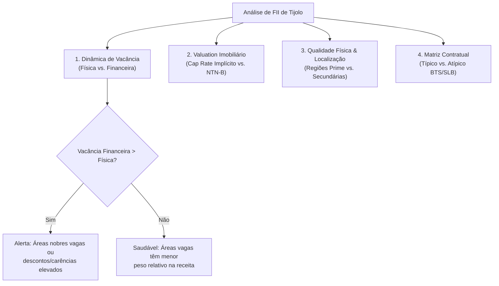
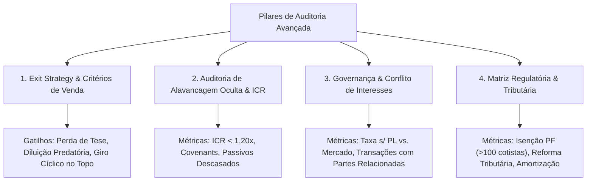
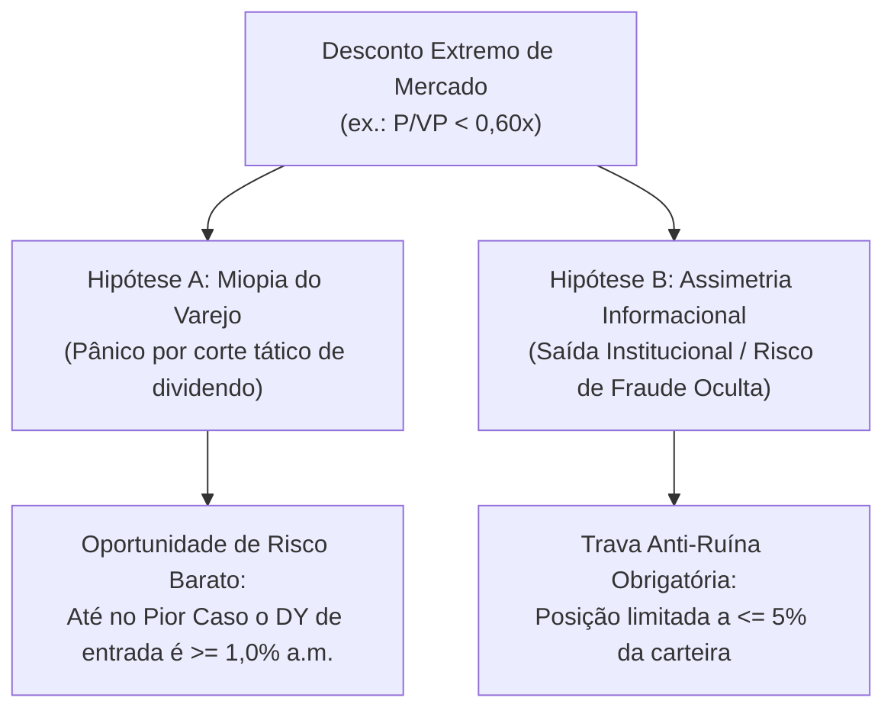

# Skill: Análise Fundamentalista e Valuation de Fundos Imobiliários (FIIs)

Esta skill estabelece o framework técnico-analítico padrão **CNPI (Certificado Nacional do Profissional de Investimento)** para avaliação de **Fundos de Investimento Imobiliário (FIIs)** listados na B3. Seu objetivo é orientar diagnósticos de carteira, precificação relativa, avaliação de risco de crédito/imobiliário e alocação tática/estratégica sem vieses comportamentais ou armadilhas superficiais de *Dividend Yield* pontual.

---

## 1. Quando Acionar Esta Skill (Gatilhos Operacionais)

- Avaliação individual de FIIs de **Tijolo** (Logística, Shoppings, Lajes Corporativas, Renda Urbana, Agro/Híbridos) e de **Papel / Recebíveis** (CRIs *High Grade*, *Middle Risk* ou *High Yield*).
- Diagnóstico estrutural e rebalanceamento de carteiras de FIIs frente ao ciclo da taxa Selic (CDI) e das curvas de juros reais (NTN-B / IPCA+).
- Identificação de assimetrias de valuation ($P/VP$), oportunidades de ganho de capital ou **armadilhas de valor (*Value Traps*)**.
- Auditoria de risco de crédito em carteiras de CRIs e risco locatício em contratos típicos e atípicos.

---

## 2. Fórmulas e Leitura Crítica de Valuation ($P/VP$)

O indicador **Preço sobre Valor Patrimonial ($P/VP$)** compara a cotação de mercado do fundo na bolsa com o Valor Patrimonial por Cota ($VPA$) contábil:

$$VPA = \frac{\text{Ativo Total (Imóveis ou CRIs + Caixa)} - \text{Passivo Total (Obrigações por Aquisição / Securitizações)}}{\text{Quantidade Total de Cotas Emitidas}}$$

$$P/VP = \frac{P_{\text{mercado}}}{VPA}$$

> [!IMPORTANT]
> O significado econômico do $P/VP$ é **radicalmente distinto** entre Fundos de Tijolo e Fundos de Papel. Nunca aplique a mesma régua interpretativa para ambas as classes.

### 2.1 Leitura do $P/VP$ em Fundos de Papel (CRIs)
Nos fundos de recebíveis, o $VPA$ reflete o valor de marcação a mercado (ou na curva) de títulos de dívida com valor de face finito (par = $1,00$).

- **Ágio ($P/VP > 1,00$):**
  - Ao pagar $P/VP > 1,00$ (ex.: $1,03$ a $1,06$) em um fundo de papel, o investidor paga um prêmio sobre o principal de uma dívida que, no vencimento ou em uma **amortização extraordinária / pré-pagamento**, devolverá apenas $1,00 \times VPA$ (ou uma multa residual baixa).
  - **Consequência Matemática:** O ágio reduz a Taxa Interna de Retorno (TIR) efetiva do cotista em relação ao cupom da carteira:
    $$\text{TIR}_{\text{efetiva}} \approx \text{Taxa Média da Carteira} - \frac{(P/VP - 1)}{\text{Duration Média (anos)}}$$
  - **Regra de Decisão:** Em fundos *High Grade* (especialmente indexados ao CDI ou mistos), um leve ágio de até $1,01\text{–}1,02$ pode ser tolerado para manutenção em carteira pela qualidade fiduciária e liquidez, mas **novos aportes acima de $P/VP = 1,02$ devem ser evitados ou postergados**, priorizando pares *High Grade* negociados na paridade ($P/VP \le 1,00$).
- **Deságio ($P/VP < 1,00$):**
  - **Oportunidade (Deságio de Marcação a Mercado):** Ocorre quando a abertura da curva de juros reais (NTN-B) reduz contabilmente o preço dos CRIs atrelados ao IPCA, mesmo com 100% dos devedores adimplentes. Comprar a $P/VP$ entre $0,85$ e $0,95$ nesses casos permite capturar um **Yield Implícito** superior à taxa de emissão original dos papéis.
  - **Armadilha de Valor (*Value Trap* de Crédito):** Ocorre quando o mercado precifica na cota (antes do reconhecimento contábil da provisão para devedores duvidosos — PDD) eventos de inadimplência, renegociação forçada (*waivers* sucessivos), carência de juros ou garantias ilíquidas em CRIs *High Yield* ou pulverizados.

### 2.2 Leitura do $P/VP$ em Fundos de Tijolo
Nos fundos de imóveis físicos, o $VPA$ decorre de laudos de avaliação patrimoniais (elaborados anualmente por consultorias independentes via Fluxo de Caixa Descontado — FCD).

- **Oportunidade Legítima ($P/VP < 0,95$):**
  - Portfólio composto por ativos *Prime* / Classe AAA, com baixa vacância estrutural, inquilinos de primeira linha e custo de reposição por $\text{m}^2$ superior ao preço implícito na bolsa. O desconto decorre puramente do ciclo macroeconômico (taxa de desconto elevada exigida pelo mercado frente à NTN-B longa).
- **Armadilha de Valor (*Value Trap* Imobiliário):**
  - **Laudo Defasado ou Otimista:** O $VPA$ contábil assume absorção rápida de áreas vagas ou aluguéis por $\text{m}^2$ acima da realidade praticada na região.
  - **Obsolescência Técnica e Localização Secundária:** Lajes corporativas antigas (Classe B/C) sem retrofits viáveis ou galpões logísticos com pé-direito baixo ($< 10\text{ m}$) e baixa capacidade de piso, incapazes de reter inquilinos.
  - **Alavancagem Destrutiva (*Passivo a Descoberto*):** Fundo com obrigações por aquisição de imóveis (CRIs no passivo) vencendo no curto prazo sem caixa suficiente, forçando emissões de cotas abaixo do $VPA$ (diluição severa dos cotistas) ou venda forçada dos melhores imóveis (*fire sale*).

---

## 3. Análise de Fundos de Papel (Recebíveis Imobiliários / CRIs)

### 3.1 Indexadores e Dinâmica Macroeconômica (CDI vs. IPCA)

| Critério Analítico | Indexador Pós-Fixado (CDI + Spread) | Indexador Inflação (IPCA + Cupom) |
| :--- | :--- | :--- |
| **Comportamento na Alta da Selic** | Elevação imediata dos dividendos nominais mensais; baixa volatilidade da cota no mercado secundário. | Pressão negativa sobre o $VPA$ e cotação (marcação a mercado pela abertura das NTN-Bs). |
| **Comportamento na Queda da Selic** | Queda progressiva e direta nos rendimentos mensais distribuídos. | Fechamento da curva real valoriza o $VPA$ e abre espaço para ganhos de capital na cota. |
| **Proteção contra a Inflação** | **Parcial/Indireta:** Todo o juro nominal (incluindo a inflação implícita no CDI) é pago em caixa. Se o investidor gastar 100% do dividendo, seu principal perde poder de compra real. | **Estrutural:** A correção monetária (IPCA) protege o poder de compra (retida no $VPA$ no regime competência ou distribuída junto ao cupom no regime caixa). |
| **Risco Sazonal de Curto Prazo** | Baixo (depende apenas do número de dias úteis no mês). | Alto em meses de desaceleração inflacionária ou deflação (IPCA negativo corrói a distribuição mensal com defasagem de 1 a 2 meses). |

### 3.2 Spread de Crédito Médio e Perfil da Carteira
O **Spread de Crédito** é o prêmio de risco cobrado acima do título soberano de mesma duration (NTN-B ou DI Futuro):
$$\text{Spread de Crédito} = \text{Taxa de Aquisição/MTM do CRI} - \text{Taxa da NTN-B de Mesma Duration}$$

1. **High Grade (Baixo Risco de Crédito):**
   - Devedores corporativos de grande porte (*investment grade*) ou carteiras com fortíssima estrutura de garantias em regiões primárias.
   - Taxas típicas de originação/carrego: $\text{CDI} + 1,2\%\text{ a }2,5\%\text{ a.a.}$ ou $\text{IPCA} + 6,5\%\text{ a }8,5\%\text{ a.a.}$ (spread de $100\text{ a }250\text{ bps}$ sobre a NTN-B).
2. **Middle Risk (Risco Moderado / Estruturado):**
   - Operações corporativas de médio porte, *built-to-suit* alavancados ou pulverizados maduros com subordinação robusta.
   - Taxas típicas: $\text{CDI} + 2,5\%\text{ a }4,0\%\text{ a.a.}$ ou $\text{IPCA} + 8,5\%\text{ a }10,0\%\text{ a.a.}$
3. **High Yield (Alto Risco / Desenvolvimento / Multipropriedade):**
   - Loteamentos em fase de obras, multipropriedade turística, incorporação sem *funding* completo ou empresas alavancadas.
   - Taxas típicas: $\text{IPCA} + 10,5\%\text{ a }14,0\%+\text{ a.a.}$ Exige monitoramento rigoroso de **Razão de Garantia (LTV)**, ** Fluxo Mensal de Recebíveis vs. PMT** e **Acionamento de Fundo de Reserva**.

### 3.3 Duration e Estrutura de Garantias
- **Duration de Macaulay / Modificada:** Mede o prazo médio ponderado de recebimento dos fluxos de caixa do CRI (geralmente entre $3,0$ e $6,0\text{ anos}$). Quanto maior a *duration*, maior a sensibilidade do $VPA$ à variação dos juros de longo prazo:
  $$\frac{\Delta VPA}{VPA} \approx -D_{\text{mod}} \times \Delta y_{\text{real}}$$
- **Checklist Obrigatório de Garantias (Tríade de Proteção):**
  1. **Alienação Fiduciária (AF) de Imóveis:** Permite consolidação extrajudicial da propriedade em caso de inadimplência. Verificar sempre o $LTV = \frac{\text{Saldo Devedor}}{\text{Valor de Avaliação Forçada do Imóvel}}$ (idealmente $\le 65\%\text{–}70\%$).
  2. **Cessão Fiduciária (CF) de Recebíveis / Contratos de Locação:** Os aluguéis ou prestações dos compradores finais pingam diretamente em uma **Conta Vinculada (*Escrow Account*)** controlada pela securitizadora antes de chegar ao devedor.
  3. **Fundo de Reserva (FR) e Subordinação:** Colchão de liquidez imediata (ex.: 2 a 6 PMTs retidas em caixa) e cotas/séries subordinadas que absorvem as primeiras perdas (*first-loss*).

---

## 4. Análise de Fundos de Tijolo (Ativos Imobiliários Reais)

### 4.1 Vacância Física vs. Vacância Financeira
- **Vacância Física:** Percentual da Área Bruta Locável (ABL) total que se encontra desocupada:
  $$\text{Vacância Física} = \frac{\text{ABL Vaga (m}^2\text{)}}{\text{ABL Total do Portfólio (m}^2\text{)}}$$
- **Vacância Financeira:** Percentual da receita potencial máxima que deixa de ser arrecadada devido a áreas vagas ou carências/descontos:
  $$\text{Vacância Financeira} = 1 - \frac{\text{Receita de Locação Efetiva}}{\text{Receita Potencial Total da ABL a Preço de Tabela}}$$
- **Diagnóstico Cruzado:**
  - Se $\text{Vacância Financeira} > \text{Vacância Física}$: Sinal de alerta — os imóveis ou andares vagos são justamente os de maior valor por $\text{m}^2$ do fundo, ou a gestão precisou conceder fortes descontos/carências para reter inquilinos.
  - Acompanhar também a **Absorção Líquida** do mercado regional e o **Cronograma de Vencimento e Revisional** dos contratos (concentração de vencimentos nos próximos 12–24 meses).

### 4.2 Cap Rate Implícito e Spread sobre a Renda Fixa Soberana
O **Cap Rate (*Capitalization Rate*) Implícito** mede o retorno operacional líquido (*Net Operating Income* — NOI) dos imóveis em relação ao valor total pelo qual o mercado avalia os ativos na bolsa (incluindo a dívida líquida):

$$\text{Enterprise Value (EV)} = \text{Valor de Mercado (Cota} \times \text{Nº Cotas)} + \text{Obrigações Imobiliárias Líquidas de Caixa}$$

$$\text{Cap Rate Implícito} = \frac{\text{NOI Anualizado (12 meses)}}{\text{Enterprise Value (EV)}}$$

- **Regra da Alavancagem Positiva vs. Negativa:**
  - Se o fundo possui dívida (CRIs de aquisição) a um custo de $\text{IPCA} + 8,5\%$ para comprar um imóvel cujo Cap Rate é de $8,0\%$, há **alavancagem destrutiva** (o custo da dívida corrói o fluxo de caixa dos cotistas).
  - A alavancagem só é saudável quando $\text{Cap Rate do Imóvel} > \text{Custo Efetivo da Dívida}$, com cronograma de amortização casado com a geração de caixa orgânica (sem depender de lucro extraordinário na venda de ativos para pagar juros).

### 4.3 Localização (Regiões Prime vs. Secundárias) e Especificação Técnica
A barreira de entrada imobiliária (*moat*) reside na localização insubstituível e na especificação construtiva:
1. **Galpões Logísticos e Industriais:**
   - **Prime (Raio 30 km das capitais, especialmente São Paulo):** Vocação para *last-mile* (e-commerce), altíssima liquidez de relocação, baixa vacância estrutural.
   - **Especificação Técnica Classe AAA:** Pé-direito livre $\ge 12\text{ m}$, piso nivelado a laser com resistência $\ge 6\text{ ton/m}^2$, amplo pátio de manobra, relação otimizada de docas por $\text{m}^2$ e sistema de combate a incêndio *Sprinklers* categoria J4/ESFR.
2. **Lajes Corporativas (Escritórios):**
   - **Eixos Prime:** Faria Lima, Itaim Bibi, Juscelino Kubitschek, Vila Olímpia e Paulista (SP). Regiões com escassez de terrenos mantêm ocupação superior a $90\%$ e repassam inflação acima do IPCA mesmo em ciclos adversos.
   - **Regiões Secundárias / Periféricas (ex.: Alphaville, Barra da Tijuca secundária, Centro antigo):** Sofrem com excesso de oferta estrutural, vacância crônica e perda real no valor de locação por $\text{m}^2$.
3. **Shopping Centers:**
   - Avaliar **Dominância Regional** (shoppings líderes de fluxo na sua área de influência primária), **Vendas/$\text{m}^2$**, **NOI/$\text{m}^2$**, crescimento de **Same Store Sales (SSS)** e **Same Store Rent (SSR)** acima da inflação, **Custo de Ocupação** saudável para o lojista ($< 10\%\text{–}12\%$ das vendas) e **Inadimplência Líquida** controlada ($< 3\%$).

### 4.4 Risco de Renovação: Contratos Típicos vs. Contratos Atípicos (*BTS / SLB*)

| Dimensão | Contrato Típico (Locação Comercial Padrão) | Contrato Atípico (*Built-to-Suit* / *Sale-and-Leaseback*) |
| :--- | :--- | :--- |
| **Prazo Médio (WAULT)** | Curto a Médio ($3\text{ a }5\text{ anos}$) | Longo ($10\text{ a }20+\text{ anos}$) |
| **Multa Rescisória** | Proporcional ao tempo restante (usualmente $3\text{ a }6\text{ aluguéis}$) | **Integral:** Saldo total de todos os aluguéis vincendos até o fim do contrato |
| **Ação Revisional (Ano 3)** | Permitida para ambas as partes (marcação do aluguel a mercado) | Geralmente renunciada em contrato (reajuste estrito por IPCA/IGP-M) |
| **Natureza do Risco na Vigência** | Risco de vacância e ciclo imobiliário local | **Risco de crédito corporativo** do locatário |
| **Risco na Renovação (*Cliff Risk*)** | Moderado: o aluguel já vem sendo ajustado gradualmente ao mercado | **Alto:** Se o imóvel foi construído sob medida (específico) ou em região secundária com aluguel inflado pelo *capex* inicial, na data de vencimento o inquilino pode desocupar ou exigir redução drástica (*step-down*) do aluguel |

---

## 5. Diretrizes de Alocação e Rebalanceamento de Portfólio

1. **Equilíbrio Tijolo vs. Papel:**
   - **Base Estrutural Recomendada (Investidor Renda & Crescimento Patrimonial):** Entre **60% e 70% em Tijolo** (proteção patrimonial real, valorização do $\text{m}^2$ e repasse inflacionário secular) e **30% a 40% em Papel** (geração de caixa elevada, amortecimento de volatilidade da carteira e captura de juros reais/nominais altos).
   - Dentro da fatia de **Papel**, equilibrar indexadores entre **IPCA+** (proteção real e ganho de capital no fechamento de curva) e **CDI+** (estabilidade de cota e caixa imediato enquanto a Selic permanecer em dois dígitos).
2. **Limites Prudenciais de Concentração:**
   - **Por Ativo Individual:** Peso-alvo ideal entre **8% e 12%** para posições *Core* (teto máximo prudencial de **15%** em um único FII blue-chip multiativo/multi-inquilino).
   - **Por Segmento:** Nenhum segmento isolado de tijolo deve ultrapassar **30% a 35%** do portfólio total; a fatia de papel deve ser distribuída entre pelo menos 3 gestoras/estratégias distintas.
3. **Classificação Tática de Ativos no Rebalanceamento:**
   - **Comprar (Aporte Prioritário):** Fundos com fundamentos sólidos, gestão comprovada, negociados abaixo do Valor Patrimonial ($P/VP < 1,00$, com margem de segurança real) e abaixo do peso-alvo na carteira.
   - **Aguardar / Manter (Neutralidade):** Excelentes ativos cujo preço atual já reflete o valor justo ou apresenta leve ágio ($P/VP \ge 1,00$ em papel ou próximo de $1,00$ em tijolo), ou cujo peso atual na carteira já atingiu o teto estratégico. Mantêm-se as cotas para colheita de proventos, direcionando novos aportes para ativos descontados.
   - **Monitorar / Reduzir (Atenção a Riscos ou Assimetria Desfavorável):** Ativos passando por transição operacional/gestão, alavancagem elevada que exige acompanhamento de reciclagem de ativos, ou sobrepeso relativo frente ao risco/retorno.

### 5.1 Base Científica da Diversificação Ótima (10 a 15 FIIs) e Classes Complementares

1. **Curva de Redução do Risco Idiossincrático (*Markowitz, 1952; Evans & Archer, 1968; Statman, 1987*):**
   - A variância total de uma carteira equiponderada de $N$ ativos é dada por:
     $$\sigma_p^2 = \frac{1}{N}\overline{\sigma}_i^2 + \left(1 - \frac{1}{N}\right)\overline{\text{Cov}}(i, j)$$
   - À medida que $N$ cresce de $1$ para **$12\text{ a }15\text{ FIIs}$** distribuídos entre segmentos com baixa correlação cruzada (Papel CDI, Papel IPCA, Logística, Shoppings, Lajes, Renda Urbana), **cerca de 85% a 90% do risco idiossincrático (específico de cada fundo/gestora) é eliminado**, restando essencialmente a covariância sistêmica de mercado ($\overline{\text{Cov}}(i, j)$, ligada ao ciclo da Selic e das NTN-Bs).
   - Acima de **15 a 18 FIIs**, o benefício marginal de redução de risco ($\partial \sigma_p / \partial N$) torna-se estatisticamente insignificante, gerando **sobrediversificação (*diworsification*)**, diluição da capacidade de acompanhamento dos relatórios gerenciais e convergência passiva ao índice IFIX.
2. **Paridade de Fatores Macroeconômicos (*Arbitrage Pricing Theory — Ross, 1976 & All-Weather*):**
   - A combinação de **FIIs de Papel (~35%)**, **FIIs de Tijolo Tradicional (~35% a 45%)** e **Híbridos / Renda Urbana (~10% a 15%)** atua como um hedge natural de *duration*: quando a inflação ou a Selic sobem (choque monetário), os fundos de papel expandem nominalmente seus distribuíveis; quando os juros reais longos fecham (expansão econômica), os fundos de tijolo e híbridos capturam ganho de capital via fechamento de *cap rate* e reajuste real dos aluguéis.
3. **Avaliação Científica de FoFs (Fundos de Fundos) vs. FIIs Multiestratégia (*Sharpe, 1991 — The Arithmetic of Active Management*):**
   - Para carteiras que já possuem entre 10 e 15 FIIs selecionados diretamente, alocar em **FoFs tradicionais puros** incorre em **dupla camada de taxas de administração e performance** (~$0,8\%\text{–}1,2\%\text{ a.a.}$ no FoF sobrepostos a ~$0,8\%\text{–}1,0\%\text{ a.a.}$ nos FIIs-alvo), gerando *overlapping* (sobreposição com ativos que o investidor já detém diretamente).
   - A adição de FoFs ou **FIIs Multiestratégia (*Hedge Funds* imobiliários)** só se justifica matematicamente quando:
     1. O veículo é um **Multiestratégia** capaz de originar CRIs exclusivos, investir em SPEs/permutas e arbitrar descontos sem se limitar à compra passiva de cotas no secundário; ou
     2. O FoF/Multiestratégia é adquirido com **forte duplo desconto patrimonial ($P/VP \le 0,90$)**, de modo que o deságio de entrada compense integralmente o valor presente da segunda camada de taxa de gestão.
4. **Risco-Retorno em FIIs de Desenvolvimento Imobiliário:**
   - Fundos de desenvolvimento (construção/loteamento/incorporação para venda) operam sob lógica de **ganho de capital e ciclo de obras (INCC)**, e não de renda imobiliária estabilizada. Apresentam maior volatilidade de fluxo de caixa e risco de execução, devendo ser limitados a uma fatia tática ($\le 5\%\text{–}10\%$) apenas em portfólios que já consolidaram seu núcleo gerador de renda recorrente.

### 5.2 Fundamentação Matemática e Científica da Alocação Padrão (35% Tijolo / 35% Papel / 15% Híbrido / 10% FoF-Multi / 5% Desenvolvimento)

Esta distribuição percentual não é arbitrária nem baseada em intuição; ela decorre da aplicação da **Teoria Moderna do Portfólio (Markowitz, 1952)**, da **Arbitrage Pricing Theory (APT - Ross, 1976)** e do **Critério de Kelly Fracionário para Risco de Ruína** aplicados às características estruturais do mercado imobiliário e de crédito brasileiro:

1. **Equilíbrio de Fronteira Eficiente (Maximização do Índice de Sharpe):**
   - **Papel (35%) — O Motor de Carry e Rendimento Nominal:** Títulos de dívida imobiliária (CRIs) apresentam volatilidade de cota significativamente inferior aos ativos de tijolo e oferecem prêmio de risco imediato sobre o CDI ou IPCA. Sua função matemática na carteira é ancorar o retorno em dividendo mensal recorrente ($\ge 1,0\%\text{ a.m.}$) e reduzir a variância de curto prazo do portfólio.
   - **Tijolo Tradicional (35%) — O Motor de Preservação Real e Convexidade:** Imóveis físicos (logística prime, shoppings consolidados, lajes de padrão corporativo superior) possuem valor intrínseco indexado ao custo de reposição construtiva e contratos corrigidos pela inflação (IPCA/IGP-M). Em momentos de queda da taxa de desconto (fechamento de curva de juros reais longos), os fundos de tijolo oferecem **convexidade positiva**, capturando ganho de capital expressivo que compensa a menor distribuição nominal de proventos.
   - **A Paridade 35/35 como Hedging Cruzado:** O cruzamento das séries históricas de Tijolo e Papel revela uma covariância negativa em janelas de choque monetário: enquanto a cota de tijolo sofre com a alta da Selic, o rendimento de papel expande; quando a Selic cai, o dividendo de papel recua em direção a um dígito, mas a cota de tijolo explode em valorização patrimonial. A divisão balanceada de 35% e 35% atua como um estabilizador dinâmico do patrimônio global.

2. **Híbridos / Renda Urbana (15%) — O Amortecedor de Baixo Beta:**
   - Imóveis de varejo essencial (supermercados, atacarejos, farmácias, laboratórios de diagnóstico e hospitais) operam sob contratos atípicos de longuíssimo prazo ($> 10\text{ a }15\text{ anos}$) com multas rescisórias integrais. Eles combinam a segurança física do tijolo com a previsibilidade contratual do papel, servindo como uma "ponte de baixa volatilidade" que reduz o *drawdown* máximo da carteira sem sacrificar dividendos.

3. **FoFs / Multiestratégia (10%) — O Vetor de Alpha e Deságio Duplo:**
   - Limitar a fatia de FoFs/Hedge Funds a 10% é uma imposição da **Aritmética da Gestão Ativa (Sharpe, 1991)**: se o investidor alocasse 30% a 40% em FoFs, o pagamento de uma segunda taxa de administração e performance drenaria entre $0,6\%\text{ e }1,0\%\text{ a.a.}$ da rentabilidade líquida total da carteira. Em uma dose controlada de 10%, o portfólio captura o benefício das arbitragens táticas, originação exclusiva de CRIs e captura de cotas com duplo deságio ($P/VP \le 0,85\text{–}0,90$) sem comprometer o retorno líquido pelo excesso de taxas.

4. **Desenvolvimento Imobiliário (5%) — A Opção Assimétrica e o Teorema da Ruína:**
   - Fundos de loteamento, incorporação e venda de SPEs residenciais não são ativos de renda estabilizada; são equivalentes a uma **opção de compra (*call option*) alavancada no ciclo imobiliário**. Apresentam alto risco de execução de obra, distratos contratuais, atraso de recebíveis e flutuação abrupta de resultado caixa.
   - Pelo **Critério de Kelly Fracionário**, posições com volatilidade extrema e risco de cauda devem ser estritamente contidas entre **3% e 5%** (com teto improrrogável de 10%). Uma alocação de 5% permite ao investidor capturar lucros extraordinários e yields agressivos quando as obras são entregues e os lotes quitados, sem que um eventual calote ou travamento de liquidez de SPEs ameace a estabilidade da renda mensal da família.

5. **Imunização e Gestão de Duration da Carteira:**
   - A *duration* combinada de uma carteira 35/35/15/10/5 situa-se na faixa ótima de **$4,0\text{ a }5,5\text{ anos}$**, casando perfeitamente a necessidade de recebimento de caixa no curto prazo com a proteção contra a perda do poder de compra no horizonte de 10 a 20 anos.

---

## 6. Regra Obrigatória de Pente-Fino Duplo Pré-Recomendação (Documental + Macro/Micro/Político/Global)

> **[!IMPORTANT] REGRA DE OURO INEGOCIÁVEL (DUPLA MALHA FINA):**  
> **NUNCA recomende a compra ou inclusão de qualquer FII sem antes aprová-lo sequencialmente em DUAS ETAPAS eliminatórias:**
> 1. **Etapa 1 — Pente-Fino Documental e Operacional (Micro-Fundo):** Auditoria rigorosa dos documentos oficiais mais recentes da B3/CVM.
> 2. **Etapa 2 — Pente-Fino Macroeconômico, Microeconômico, Político-Eleitoral e Geopolítico Global:** Verificação de aderência e resiliência do fundo frente ao ciclo econômico, tendências setoriais seculares, cenários políticos/eleitorais domésticos e choques geopolíticos globais.

### 6.1 Etapa 1: Checklist Obrigatório de Auditoria Documental
Antes de avançar qualquer FII para a análise de cenário, inspecione obrigatoriamente os últimos comunicados na B3 / CVM / Investidor10:

1. **Assembleias Gerais Extraordinárias (AGEs) e Consultas Formais:**
   - Verificar se há propostas em andamento de **liquidação/dissolução do fundo**, venda integral de ativos, incorporação desfavorável ou conflito de interesses. *(Critério de Reprovação Imediata: fundos em processo de extinção/liquidação).*
2. **Ofertas Públicas (Emissões de Cotas):**
   - Checar o preço de emissão frente ao Valor Patrimonial ($VPA$). **Reprovar** fundos que realizem emissões diluidoras abaixo do $VPA$ sem justificativa ou que tenham emitido bilhões via troca de cotas (*compensação de créditos*) gerando forte pressão vendedora secundária (*seller overhang*) no curto prazo, combinada com alavancagem excessiva ($> 25\%\text{–}30\%$).
3. **Fatos Relevantes:**
   - Rastrear anúncios de inadimplência de locatários/CRIs, rescisões contratuais, pedidos de Recuperação Judicial (RJ) de devedores/arrendatários, embargos de obras/concessões públicas, reavaliações patrimoniais negativas (*impairment*) ou cortes abruptos de *guidance* de dividendos.
4. **Relatórios Gerenciais e Informes Mensais:**
   - Confirmar se o dividendo distribuído é coberto pelo **Resultado Caixa Recorrente** (evitando fundos que estão esgotando reservas para mascarar queda de receita operacional) e validar a saúde do passivo (cronograma de amortização de dívidas vs. caixa disponível).
5. **Avisos aos Cotistas — Distribuições:**
   - Validar a estabilidade dos proventos nos últimos meses e a relação entre o rendimento atual e a cotação de mercado.

### 6.2 Etapa 2: Filtro Macroeconômico, Microeconômico, Político-Eleitoral e Geopolítico Global
Mesmo que um FII seja aprovado na Etapa 1 (documentos em dia), ele **DEVE SER BARRADO OU SUBSTITUÍDO** se o seu setor, tese ou carteira de locatários/devedores apresentar fragilidade estrutural nos 4 eixos abaixo:

1. **Filtro Microeconômico e Tecnológico Setorial (Risco de Obsolescência e Ciclo de Crédito):**
   - **Transformação Digital e Demanda Secular:** Avaliar se o tipo de imóvel sofre obsolescência estrutural (ex.: **agências bancárias físicas de rua**, que vêm sendo fechadas em massa pelos bancos devido ao Pix e digitalização bancária) versus setores com vento de cauda secular (ex.: **Data Centers / IA / Cloud, Logística *Last-Mile* de E-commerce, Laboratórios de Saúde**).
   - **Saúde Financeira Setorial dos Inquilinos/Devedores:** Reprovar fundos expostos a setores que estejam atravessando ondas sistêmicas de **Recuperação Judicial (RJ)** ou compressão severa de margens operacionais (ex.: **Agronegócio / Terras Agrícolas e Fiagros** durante ciclos de Selic elevada + custos de insumos dolarizados + queda de grãos; ou **Incorporação Residencial / Loteamentos** no interior durante ciclos de escassez de crédito SBPE e juros altos).
2. **Filtro Macroeconômico Doméstico (Juros, Inflação e Fiscal):**
   - Testar a sensibilidade do fundo à curva de juros reais (NTN-B) e à Selic: fundos que dependem de giro constante de ativos no mercado secundário ou de venda de SPEs residenciais sofrem travamento de liquidez quando a Selic permanece alta por desancoragem fiscal. Priorizar veículos com geração de caixa recorrente pura (contratos atípicos IPCA+ ou crédito *High Grade* CDI+/IPCA+ com baixo LTV).
3. **Filtro Político-Eleitoral (Matriz de Cenários Presidenciais — Esquerda vs. Direita):**
   - Todo ativo recomendado deve sobreviver e performar bem sob **ambos os cenários políticos binários** no Brasil:
     - **Cenário de Vitória da Esquerda (Expansão Fiscal / Estado Indutor):** Maior pressão inflacionária (IPCA) e juros reais (Selic/NTN-B) estruturalmente mais elevados; maior risco regulatório/tributário e atrito político sobre setores específicos como o grande agronegócio exportador; em contrapartida, resiliência no consumo básico, varejo/logística de e-commerce e repasse inflacionário em contratos atípicos e CRIs *High Grade*.
     - **Cenário de Vitória da Direita (Ajuste Fiscal / Desregulamentação):** Fechamento da curva de juros longos (forte reprecificação positiva de FIIs de tijolo prime comprados com $P/VP < 0,90$), porém com necessidade de avaliar os reflexos de alinhamentos geopolíticos externos.
4. **Filtro Geopolítico e Macro Global (Comércio Internacional, China, EUA e Commodities):**
   - Avaliar a exposição indireta do fundo a choques externos: guerras tarifárias (**EUA vs. China**), desaceleração chinesa (que impacta diretamente o **agronegócio exportador brasileiro**, dado que a China absorve $>70\%$ da soja nacional), choques de petróleo/câmbio e tendências globais de *nearshoring* e infraestrutura digital.

---

## 7. Protocolo Obrigatório de Resposta Analítica Prévia (Padrão de Apresentação de FIIs)

> **[!IMPORTANT] REGRA INEGOCIÁVEL DE APRESENTAÇÃO AO INVESTIDOR:**  
> **SEMPRE que for analisar qualquer fundo OU recomendar um novo FII, comece OBRIGATORIAMENTE enviando o Raio-X Operacional e de Riscos ANTES de apresentar qualquer simulação financeira da carteira.** O investidor nunca deve ver uma simulação de dividendos sem antes conhecer a fundo o que está acontecendo por trás do número.

### 7.1 Estrutura Padrão de Análise de Cada Fundo (Template Obrigatório)

Para cada ativo analisado ou recomendado, siga estritamente o formato:

1. **Cabeçalho Fundamentalista e Múltiplos:**
   - `Ticker` (Nome da Gestora / Fundo — Categoria Real da Carteira)
   - `Preço Atual` | `P/VP` | `Último Dividendo / Cota` | `DY Mensal (% a.m.)` | `DY Anualizado (% a.a.)`
   *(Regra de Formatação KaTeX: sempre envolver valores em reais em crases `` `R$ X,XX` `` ou usar `R\$` para evitar que o símbolo de cifrão ative blocos matemáticos KaTeX indevidos).*
2. **O Que Está Acontecendo no Fundo (Raio-X dos Relatórios Oficiais Recentes):**
   - **Composição do Resultado:** Origem detalhada das receitas (CRIs, aluguéis de galpões/lajes/varejo, participações em SPEs/incorporações, dividendos de outros FIIs).
   - **Geração de Caixa Real vs. Dividendo Distribuído (DRE Caixa):** Relação exata entre o resultado operacional contábil gerado no mês versus o dividendo pago por cota. Informar claramente se o dividendo é sustentado por caixa orgânico ou se consome reservas acumuladas de lucros passados.
   - **Saúde e Nível das Reservas:** Saldo de reserva de lucros por cota e autonomia estimada (quantos meses a reserva consegue cobrir eventuais furos de receita).
   - **Inadimplência, Atrasos e Garantias:** Percentual de adimplência, taxa de inadimplência, ocorrência de calotes, renegociações de prazos, alienação fiduciária e LTV médio das operações.
   - **Passivos e Alavancagem Financeira:** Saldo devedor de CRIs e obrigações a pagar (% do PL), cronograma de vencimentos e casamento de taxas/indexadores com as receitas de locação.
   - **Eventos Corporativos Relevantes:** Conclusão de obras, vendas de imóveis com ganho de capital, rescisões contratuais, devoluções de área ou desinvestimentos.
3. **⚠️ O Que É Arriscado no [Ticker] (Seção de Riscos Críticos e Específicos):**
   - Lista numerada expondo com total transparência as fragilidades do ativo:
     - Risco de exaustão de reservas e consequente corte de proventos;
     - Risco de crédito ou dependência de inquilinos/devedores específicos (ex.: GPA, construtoras alavancadas);
     - Risco de vacância, carências contratuais ou obsolescência estrutural (ex.: fechamento de agências bancárias de rua);
     - Risco de distratos e atrasos em loteamentos/obras residenciais;
     - Risco de alavancagem financeira em momentos de juros altos.
4. **🌐 Matriz Prospectiva e Visão de Cenários Futuros (Tudo o Que Pode Impactar):**
   - **Cenário Político-Fiscal Doméstico (Expansão Fiscal / Esquerda vs. Ajuste Fiscal / Direita):** Como o fundo se comporta em cenários de maior expansão fiscal (Selic/NTN-B altas e inflação) vs. ajuste fiscal e desregulamentação.
   - **Juros Futuros e Curva de Juros (NTN-B / DI):** Sensibilidade do ativo à abertura ou fechamento das taxas longas de mercado.
   - **Dinâmica da Inflação (IPCA vs. IGP-M vs. INCC):** Capacidade de repasse inflacionário nos aluguéis/juros vs. risco de descasamento no serviço da dívida.
   - **Juros Globais / EUA (Fed, Treasury 10 anos) e Câmbio (Dólar):** Efeito sobre o fluxo de capitais estrangeiros, custo de insumos de construção e política monetária do Copom.
   - **Aluguel de Cotas (*Short Interest*) e Pressão Vendedora Secundária:** Risco de fluxo vendedor decorrente de compensação de cotas em grandes emissões ou encerramento de prazos de lock-up.
   - **Cenário Base, Melhor Caso e Pior Caso (com Ponto de Entrada Quantificado):**
     - *Melhor Caso (Bull Case):* Projeção de dividendo, *Yield on Cost* ($\text{YoC}$) e valorização da cota com fechamento de juros e reciclagem lucrativa.
     - *Pior Caso (Bear Case):* Projeção de piso de proventos ($\text{DY}_{\text{Pior Caso}}$) ou estresse de preço caso o pior cenário operacional se materialize.
5. **Simulações Financeiras da Carteira (Somente Após a Análise Prévia):**
   - Apresentar o impacto financeiro exato (ganho mensal em `R$` e `% a.m.`) somente após o investidor ter total clareza da qualidade e dos riscos dos ativos recomendados.

---

## 8. Pilares Institucionais de Auditoria Avançada (Checklist CNPI Sênior)

Para garantir o mais alto nível de governança, proteção patrimonial e consistência nas recomendações, todo FII sob avaliação deve ser submetido aos 4 pilares de diligência institucional:

### 8.1 Pilar 1: Exit Strategy & Critérios Objetivos de Desinvestimento (Gatilhos de Venda e Realização de Lucro)
Investidores institucionais nunca entram em uma posição sem definir previamente os **gatilhos matemáticos e qualitativos de saída** — tanto para proteção contra perda de fundamento (*Stop Loss Fundamentalista*) quanto para **realização estratégica de ganho de capital no topo do ciclo**:

1. **Gatilhos de Perda de Tese (Stop Loss Fundamentalista):**
   - **Vacância Crônica e Irreversível:** Aumento da vacância física para $> 20\%\text{–}25\%$ em fundos de tijolo por mais de 4 trimestres consecutivos em ativos localizados em praças secundárias, sem perspectiva de absorção líquida ou com necessidade de *capex* inviável para retrofit.
   - **Ruptura de Crédito em Papel:** Ocorrência de inadimplência definitiva, pedidos de Recuperação Judicial ou execução frustrada de garantias que atinjam $> 8\%\text{ a }10\%$ do Patrimônio Líquido do fundo de papel sem provisão contábil imediata (PDD).
   - **Esgotamento Estrutural de Reservas com Inadimplência Operacional:** Fundo cujo resultado operacional caixa recorrente cai de forma permanente abaixo do dividendo pago por deterioração de carteira (e não por retenção estratégica de estoque), esgotando 100% das reservas de lucros sem plano crível de recuperação.
2. **Gatilhos de Governança e Alinhamento:**
   - **Emissão Diluidora Predatória:** Emissão de cotas abaixo do Valor Patrimonial ($VPA$) com deságio superior a $10\%$, realizada exclusivamente para aumentar a taxa de gestão da gestora ou salvar obrigações alavancadas sem consulta formal transparente aos minoritários.
3. **Gatilhos de Realização de Lucro e Giro Cíclico de Capital (Quando Vender para Obter Lucro):**
   - **Fundos de Desenvolvimento e Tijolos Cíclicos (*Trade de Ciclo de Juros*):** Ativos de desenvolvimento imobiliário (loteamentos, incorporação, *equity*) sofrem forte compressão de cotação quando os juros sobem, mas **explodem em preço e distribuição quando a taxa Selic e os juros do financiamento imobiliário caem**, destravando o poder de compra do consumidor final.
     - *Regra de Entrada:* Comprar no auge do pessimismo monetário (juros altos, vendas lentas, $P/VP$ profundamente descontado, mas com $\text{DY}_{\text{Pior Caso}} \ge 1,0\%\text{ a.m.}$).
     - *Regra de Venda com Lucro (Saída no Topo do Ciclo):* Realizar lucro (venda parcial ou integral da posição tática) quando o ciclo monetário virar para **juros baixos**, o fundo atingir seu **pico cíclico de distribuição de dividendos** (impulsionado pela desova acelerada de estoques com margem cheia) e a euforia do mercado empurrar a cota para **próximo ou acima do Valor Patrimonial ($P/VP \ge 1,00\text{–}1,10$)**.
   - **Fundos de Papel com Ágio Excessivo:** Venda parcial ou rotação tática quando um FII de CRIs atinge $P/VP \ge 1,05\text{–}1,08$, momento em que a TIR efetiva do cotista passa a ser corroída pelo sobrepreço pago acima do valor de face da dívida.
   - **Fundos de Tijolo com Cap Rate Desconectado:** Quando a cotação se valoriza a ponto de o *Cap Rate* implícito cair para níveis inferiores à taxa da NTN-B longa soberana sem que haja crescimento real de aluguel correspondente.

### 8.2 Pilar 2: Auditoria de Alavancagem Oculta & Índice de Cobertura de Juros (ICR)
A alavancagem pode ser uma ferramenta legítima de otimização de retorno ou a semente da ruína de um FII se os juros permanecerem elevados:

1. **Auditoria de Passivos Fora do Balanço e Estruturas Indiretas:**
   - Identificar obrigações por aquisição a prazo, emissões de CRIs lastreados no próprio imóvel (*securitização reversa*), cessões fiduciárias de recebíveis de aluguel e passivos em SPEs não consolidadas integralmente no balanço patrimonial.
   - Medir a **Alavancagem Líquida Total**:
     $$\text{Grau de Alavancagem} = \frac{\text{Obrigações por Aquisição} + \text{CRIs no Passivo} - \text{Caixa Disponível}}{\text{Ativo Imobiliário Total}}$$
     - *Alavancagem Saudável:* $\le 15\%$ do Ativo Total.
     - *Alavancagem Moderada:* $15\%\text{ a }25\%$ do Ativo Total (exige monitoramento do cronograma).
     - *Alavancagem Crítica:* $> 25\%\text{ a }30\%$ do Ativo Total (alto risco de diluição via emissão forçada ou venda de ativos com desconto).
2. **Índice de Cobertura de Juros e Amortização (ICR - *Interest Coverage Ratio*):**
   - Mede a capacidade da receita de aluguéis e juros cobrir o serviço da dívida:
     $$\text{ICR} = \frac{\text{NOI (Resultado Operacional Caixa dos Imóveis)}}{\text{Serviço da Dívida Anual (Juros + Amortização de CRIs do Passivo)}}$$
     - $\text{ICR} < 1,20\text{x}$: **Risco Severo de Asfixia Financeira.** O fundo gera caixa apenas para remunerar a securitizadora, deixando os cotistas expostos a cortes drásticos de proventos ou necessidade de chamadas de capital.
     - $\text{ICR} \ge 1,80\text{x}$: Estrutura confortável e segura.
3. **Risco de Covenants e Cláusulas de Vencimento Antecipado (*Cross-Default*):**
   - Verificar nos termos de securitização se há gatilhos que forcem o pagamento imediato da dívida integral, tais como: quebra de LTV máximo do imóvel garantidor, queda de receita locatícia abaixo de patamar contratual ou rebaixamento de rating da emissão.

### 8.3 Pilar 3: Checklist de Governança Fiduciária & Conflito de Interesses
A qualidade e a integridade da gestora definem o destino do capital do cotista em momentos de estresse:

1. **Base de Cálculo e Alinhamento da Taxa de Gestão:**
   - **Melhor Prática Institucional:** Gestoras que cobram taxa sobre o **Valor de Mercado** das cotas (e não sobre o Patrimônio Líquido contábil) quando o fundo negocia com deságio. Isso alinha o bolso do gestor com o patrimônio do cotista.
   - **Prática Predatória (*Fee Grabbing*):** Cobrança sobre o PL Contábil inflado combinada com emissões contínuas abaixo do valor patrimonial para inflar o faturamento da gestora à custa da diluição da base existente.
2. **Transações com Partes Relacionadas:**
   - Investigar se o FII adquire CRIs originados pela própria securitizadora do grupo econômico da gestora, se compra imóveis de veículos fechados ou incorporadoras ligadas aos sócios, e se houve laudo de avaliação independente e aprovação por maioria em AGE qualificada.
3. **Taxas Ocultas de Estruturação e Originação:**
   - Em fundos de recebíveis e multiestratégia, checar se as taxas de estruturação de crédito imobiliário (usualmente de $1,0\%\text{ a }3,0\%$ do volume emitido) são revertidas integralmente para o caixa do fundo ou retidas na pessoa jurídica da gestora.
4. **Alinhamento e *Skin in the Game*:**
   - Confirmar a participação dos gestores, diretores e da tesouraria da gestora como cotistas relevantes do fundo, bem como a realização de programas formais de **recompra de cotas** quando o deságio de mercado se torna aberrante.

### 8.4 Pilar 4: Matriz Regulatória e Tributária de FIIs
A segurança jurídica é a premissa de qualquer alocação de longo prazo:

1. **Checklist de Manutenção da Isenção Tributária para Pessoa Física:**
   - De acordo com a Lei nº 8.668/1993, com as atualizações da Lei nº 11.033/2004 e marcos regulatórios posteriores (Lei nº 14.754/2023), o investidor pessoa física só goza de isenção de Imposto de Renda sobre os rendimentos se o FII cumprir cumulativamente:
     1. Possuir **pelo menos 100 cotistas** (critério mínimo de dispersão ampliado pela legislação recente);
     2. Ter suas cotas **admitidas à negociação exclusivamente em bolsas de valores ou mercado de balcão organizado**;
     3. Nenhum cotista individual (ou grupo econômico/familiar ligado) ser titular de **10% ou mais** da totalidade das cotas emitidas ou ter direito a auferir rendimentos superiores a 10% do total distribuído pelo fundo.
2. **Sensibilidade a Reformas Tributárias e Projetos de Lei:**
   - Monitorar proposições legislativas que visem a tributação de dividendos de FIIs (ex.: tributação linear na fonte de 15%):
     - *Impacto em Papel:* Redução direta e imediata do dividendo líquido recebido na conta da corretora.
     - *Impacto em Tijolo:* Maior resiliência de longo prazo, dado que o valor real dos ativos subjacentes é reajustado pela reposição e o imposto de renda pode ser parcialmente repassado na precificação dos novos contratos de aluguel.
3. **Auditoria de Amortização de Capital vs. Rendimento Distribuível:**
   - Distinguir claramente devolução de patrimônio líquido (amortização de principal) de rendimento de lucro contábil isento. A amortização reduz compulsoriamente o **preço médio de aquisição** da cota para apuração de ganho de capital futuro e não deve ser confundida com yield recorrente.

---

## 9. Psicologia de Mercado, Assimetria de "Risco Barato" e Precificação de Pontos de Entrada

Esta seção consolida os princípios avançados de leitura de fluxo institucional, dinâmica operacional de estoques imobiliários em ciclos de juros restritivos e quantificação matemática de pontos de entrada sob estresse:

### 9.1 Hipótese de Assimetria Informacional (*Insider / Smart Money*) vs. Miopia do Varejo
Diante de um FII negociado com deságio extremo na B3 (ex.: $P/VP < 0,60$), o analista nunca deve partir da premissa ingênua de que "o mercado é 100% irracional". Deve-se obrigatoriamente ponderar duas forças simultâneas:

1. **A Miopia de Curto Prazo do Investidor de Varejo:**
   - O mercado brasileiro de FIIs é majoritariamente composto por pessoas físicas hipersensíveis ao dividendo mensal imediato.
   - Quando um fundo reduz sua distribuição mensal em centavos (ex.: queda de `` `R$ 0,05 a R$ 0,15/cota` ``), o varejo traumatizado por falências de outros fundos problemáticos entra em efeito manada, vendendo cotas a qualquer preço sem analisar se o patrimônio físico continua intacto.
2. **O Risco de Cauda Oculto e Saída Institucional (*Tail Risk & Smart Money Exit*):**
   - Por outro lado, quedas brutais e contínuas com alto volume vendedor podem sinalizar que **investidores institucionais ou *insiders* (que conhecem a fundo os bastidores das SPEs e devedores) identificaram uma anomalia grave, insolvência oculta ou fraude contábil** antes de sua divulgação oficial nos relatórios gerenciais.
3. **Consequência Prática Inegociável (Trava de Position Sizing):**
   - Como é impossível para o investidor externo descartar 100% a hipótese de risco oculto/fraude em estruturas complexas (como dezenas de SPEs de desenvolvimento), **ativos com essa natureza de risco jamais podem ter peso representativo na carteira (limite máximo de $\le 5\%$)**. Assim, captura-se o *upside* explosivo se for apenas irracionalidade do varejo, mas blinda-se a carteira contra a ruína caso o cenário colapsante se materialize.

### 9.2 Diagnóstico de FIIs de Desenvolvimento: "Enrolado com Obras" vs. "Estoque Pronto Travado por Juros"
Nem todo fundo de desenvolvimento que reduz dividendos está quebrado. A auditoria deve responder a uma pergunta central: **O fundo precisa queimar caixa urgente para sustentar obras em andamento?**

| Perfil Operacional | Fundo "Enrolado com Obras" (*Value Trap*) | Fundo com "Estoque Pronto / Obras Controladas" (*Assimetria*) |
| :--- | :--- | :--- |
| **Pressão de Caixa (Capex)** | **Crítica:** Obras em fase inicial/intermediária exigem injeção maciça de dinheiro todo mês. | **Baixa:** Loteamentos e imóveis já entregues ou em fase final; sem necessidade de capex pesado. |
| **Efeito dos Juros Altos** | Paralisação de canteiros, distratos em cascata, multas contratuais e risco de insolvência das SPEs. | O produto está pronto, mas o comprador final não consegue financiamento barato para adquirir o imóvel. |
| **Poder de Barganha do Gestor** | **Zero:** Obrigado a vender ativos a preço de liquidação (*fire sale*) ou emitir cotas abaixo do VP para não parar obras. | **Total:** Pode escolher esperar a queda dos juros sem queimar o patrimônio do cotista a preço vil. |

### 9.3 O Dilema Estratégico do Gestor no Ciclo de Juros Altos (Segurar Estoque vs. Queimar Margem)
Quando a taxa Selic e os juros de financiamento imobiliário estão no topo do ciclo, o consumidor final perde capacidade de tomada de crédito. Nesse momento, o gestor de um fundo de desenvolvimento saudável tem dois caminhos:

1. **Caminho Destrutivo (Vender a Qualquer Preço para Manter Aparência de Dividendo):**
   - O gestor concede descontos de 20% a 30% no preço dos imóveis/lotes (ex.: capta `` `R$ 80 milhões` `` em um ativo projetado para vender por `` `R$ 100 milhões` ``) apenas para gerar receita caixa imediata e agradar cotistas míopes. Isso **destrói o lucro potencial do fundo, reduz o Valor Patrimonial e sacrifica até a própria taxa de performance da gestora**.
2. **Caminho Institucional Correto (Retenção Estratégica de Estoque):**
   - O gestor **recusa vender os ativos abaixo do valor justo**, comercializa apenas o mínimo necessário para cobrir despesas e distribuir um provento base menor no curto prazo, e **aguarda a virada do ciclo macroeconômico/político (queda dos juros ao consumidor)** para vender o estoque pelo preço cheio planejado.
   - **Conclusão Analítica:** Quando um fundo sem pressão de obras reduz temporariamente o provento para não queimar estoque na baixa do ciclo, o corte de dividendos **não é sinal de fraqueza estrutural, mas de proteção da rentabilidade futura do cotista**.

### 9.4 A Equação de "Comprar Risco Muito Barato" e Precificação de Pontos de Entrada
A função primordial da modelagem quantitativa e do uso de IA na análise de FIIs é **precificar matematicamente os pontos de entrada** através do teste de estresse do pior e do melhor caso:

1. **Teste de Estresse do Piso de Entrada ($\text{DY}_{\text{Pior Caso}}$):**
   - O ponto de entrada em um ativo descontado é considerado **matematicamente blindado ("comprar risco barato")** quando, mesmo que o dividendo sofra novos cortes e caia para o piso de estresse severo ($D_{\text{estresse}}$), o retorno mensal sobre o preço pago hoje ($P_{\text{entrada}}$) ainda seja altamente competitivo ($\ge 1,00\%\text{ a.m.}$):
     $$\text{DY}_{\text{Pior Caso}} = \frac{D_{\text{estresse}}}{P_{\text{entrada}}} \ge 1,00\%\text{ a.m.}$$
   - *Exemplo de Aplicação:* Se um fundo negocia a `` `R$ 50,00` `` ($P/VP < 0,50$) pagando `` `R$ 0,70/cota` `` ($1,40\%\text{ a.m.}$), e o analista projeta que, no pior cenário de travamento de vendas, o dividendo caia para `` `R$ 0,60` `` ou até `` `R$ 0,50/cota` ``, o cotista que entrou a `` `R$ 50,00` `` **ainda receberá de $1,00\%$ a $1,20\%$ ao mês livre de IR no pior dos mundos**.
2. **Cálculo da Convexidade no Melhor Caso ($\text{DY}_{\text{Melhor Caso}}$ / *Yield on Cost*):**
   - Em contrapartida, se o ciclo de juros virar e o fundo retomar sua distribuição potencial de expansão ($D_{\text{expansão}}$, ex.: `` `R$ 1,10 a R$ 1,20/cota` ``), o investidor que comprou a `` `R$ 50,00` `` passará a auferir um *Yield on Cost* ($\text{YoC}$) de **$2,20\%$ a $2,40\%$ ao mês** ($> 26\%\text{ a.a.}$ isento), somado ao potencial de valorização de $50\%$ a $100\%$ na cotação até o fechamento do desconto patrimonial:
     $$\text{YoC}_{\text{Melhor Caso}} = \frac{D_{\text{expansão}}}{P_{\text{entrada}}}$$
3. **Tabela Obrigatória de Precificação de Ponto de Entrada (Matriz de Payoff):**
   Para todo ativo com forte desconto ou volatilidade de resultado, apresentar a matriz quantitativa de entrada:

| Cenário Projetado | Dividendo Estimado / Cota | Yield Mensal sobre o Preço de Entrada ($\text{YoC}$) | Cotação-Alvo Projetada | Ganho/Perda de Capital Estimado | Diagnóstico da Relação Risco-Retorno |
| :--- | :---: | :---: | :---: | :---: | :--- |
| **Colapso Oculto (Cauda Extrema)** | Suspensão / Corte severo | $< 0,50\%\text{ a.m.}$ | Queda adicional | Perda limitada a $\le 5\%$ da carteira | Risco controlado pelo limite de peso (*Position Sizing*) |
| **Pior Caso Operacional (Estresse de Juros)** | $D_{\text{estresse}}$ (Piso de retenção) | $\ge 1,00\%\text{ a.m.}$ | Estável no piso | Neutro ($0\%$ a $-10\%$) | **Risco Barato:** Mesmo no estresse, paga $\ge 1\%\text{ a.m.}$ |
| **Cenário Base (Manutenção)** | $D_{\text{atual}}$ | $1,20\%\text{ a }1,50\%\text{ a.m.}$ | Leve fechamento | $+10\%\text{ a }+20\%$ | Carrego elevado acima da média do mercado |
| **Melhor Caso (Queda de Juros / Destravamento)** | $D_{\text{expansão}}$ (Pico do ciclo) | $> 2,00\%\text{ a.m.}$ | Convergência ao $VPA$ | $+50\%\text{ a }+100\%$ | **Ponto de Venda no Topo do Ciclo (Realização de Lucro)** |

